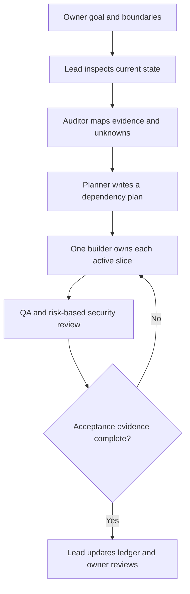

# Reusable OpenCode project factory

## Purpose

This is a reusable workflow for coordinating project work in OpenCode. It installs project-local agent prompts, slash commands and a small project-pack template. It is configuration and process, not a hosted AI service, separate application, provider account or runtime sandbox.

The factory core handles inspection, task planning, ownership, delegation, evidence and review. Each target repository supplies its own project profile, guardrails and acceptance checks. The core can therefore support software, research, data and document projects without pretending their technical or domain rules are interchangeable.

## Work cycle



Parallel work is useful for independent reading, research and tasks with separate file ownership. OpenCode child sessions do not create Git worktrees automatically. Keep writers serial in a shared checkout; use parallel writers only after creating and checking isolated worktrees with disjoint paths.

## Agent catalogue

| Agent | Mode | Responsibility | File/tool boundary |
|---|---|---|---|
| `factory-lead` | Primary | Inspect, delegate, track dependencies and report evidence | Edits only `.factory/**` with approval; can launch only the named factory subagents; safe Git inspection commands are allowed and other shell commands ask |
| `factory-auditor` | Subagent | Read-only repository and project context map | No edits, shell or further delegation |
| `factory-planner` | Subagent | Read-only dependency graph, task boundaries and acceptance criteria | No edits, shell or further delegation |
| `factory-builder` | Subagent | One task-card implementation | Every edit and shell command asks; no delegation |
| `factory-qa` | Subagent | Independent review and approved test execution | Edits denied; shell commands ask because tests may run project code |
| `factory-security` | Subagent | Read-only trust, privacy and security review | No edits, shell or further delegation |
| `factory-researcher` | Subagent | Optional source-based domain/current research | No edits or shell; web search/fetch asks |

The stable core stays small. Project packs can add domain instructions and optional specialists; do not create a permanent agent for a task that occurs once. Keep the lead as coordinator, not product-code writer.

## Project pack

Run `/factory-init` to prepare `.factory/PROJECT_PROFILE.md`, `GUARDRAILS.md`, `ACCEPTANCE.md` and `TASK_LEDGER.md` from the installed templates. Review and fill them with project-specific facts. The installer creates templates but does not populate unknown project decisions.

The templates record:

- project goal, users, boundaries, stack and source-of-truth documents;
- data sensitivity, privacy, tool and release constraints;
- team ownership and allowed work areas;
- actual test commands and acceptance requirements;
- task dependencies, owner, baseline, evidence, status and rollback.

Use task states `proposed`, `ready`, `active`, `blocked`, `needs-review` and `accepted`. An accepted state requires the listed evidence; a plan, mock, skipped check or historical result is not a pass.

## Install and use

From this repository, first preview the generated profiles:

```bash
node scripts/setup-ai-factory.mjs --target /absolute/path/to/project
```

The installer reads the installed `opencode --version` and generates the matching V1 or V2 profile format. Inspect the proposed file diff, then install with:

```bash
node scripts/setup-ai-factory.mjs --target /absolute/path/to/project --write
```

If the target is this repository, `--target` may be omitted. It must be an existing absolute directory when supplied. A changed destination, symlinked path or unsupported CLI version stops before writes. The installer never changes `AGENTS.md`, OpenCode global settings, provider credentials or owner-specific files. It does not install software or contact an AI provider.

Use the commands in order as needed:

1. `/factory-audit <goal>` — inspect evidence and current work.
2. `/factory-plan <goal>` — define owners, dependencies, acceptance and rollback.
3. `/factory-build <task-id>` — implement one bounded approved task.
4. `/factory-verify <task-id>` — run relevant approved checks and independent review.
5. `/factory-status <task-id>` — update the ledger from actual evidence.

Commands contain prompt text only; they do not include shell blocks or automatic attachments. `/factory-init` prepares the project pack without overwriting existing owner content.

## Security and verification limits

OpenCode V2 has a separate permission policy for each agent. The parent controls which subagents it may launch, and the child uses its own configured permissions. The factory config encodes both sides. V2 also treats shell commands as host-user operations; approval prompts and an agent's instructions are not a hardened filesystem sandbox. Review the actual loaded policies and do not grant blanket auto-approval.

The setup generator has an executable self-check:

```bash
node scripts/setup-ai-factory.check.mjs
```

It checks generated V1/V2 file structure, role boundaries, command templates, conflict preflight, idempotence and symlink containment. It does not launch OpenCode. No V2 runtime permission matching, prompts, subagent execution, plugins, provider calls or universal project isolation is claimed. The existing `verify-ownpath-factory.mjs` continues to report its V2 runtime limitation; this new cross-project profile set does not clear that gate.

Before using it on a project, run setup from a trusted checkout, review generated files, start OpenCode in the intended project, inspect discovered agents/commands and loaded permissions, and test the workflow on synthetic or otherwise approved data. Have an independent reviewer inspect both task results and actual evidence.
