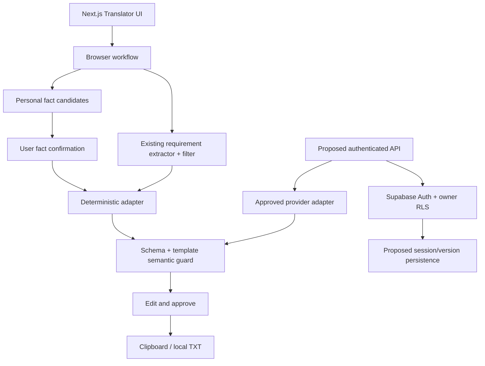
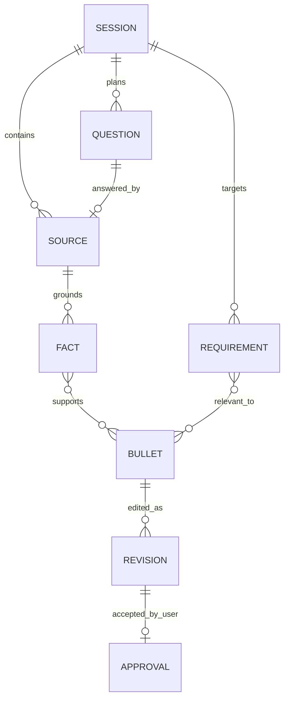

# Architecture and ADR-001

Status: proposed persistence architecture; implemented browser-only synthetic boundary. Existing Next.js 16.3.7 / React 19.2.8 / TypeScript 5.9.3 / pnpm 11.25.0 / Vitest 5.0.2 / Playwright 1.61.1 verified from installed packages on 2026-10-12. Supabase JS 2.117.2 and SSR 0.12.7. Actual PostgreSQL server version not inspected.

## Reuse decision

| Module | Decision | Constraint |
|---|---|---|
| `analysis/requirements.ts` | Reuse behind a Frontend allowlist and instruction-line filter | Heuristic, English-focused, arbitrary requirement bullets otherwise pass through |
| `analysis/matcher.ts` / `schema.ts` | Preserve old assessment only | Lexical overlap is not semantic grounding; instruction text can overlap skills |
| `next-steps/generator.ts` | Reuse principles, not composer | It arranges exact CV excerpts, no rewritten English bullets |
| `credential-versions/` | Reuse review/acceptance invalidation concepts | Student confirmation must never imply expert-reviewed proof |
| Existing `cv-export` | Defer integration | Requires accepted immutable credential-backed versions and Auth |
| Auth / API / RLS / Storage | Preserve, no prototype import | Private existing flows remain protected |

Eight migrations through `20261008_m15_atomic_next_steps.sql` are retained unchanged. `cv_draft_claims` enforces `claim_text = source_excerpt`; M15 checks source findings transactionally. New translated text cannot satisfy that invariant. Do not weaken it or force Translator into it.

Decision: pure browser types, bounded extraction, controlled English templates, semantic validation by recomposition from confirmed personal facts, user review. Avoid migrations before a persistence ADR and approval. New authenticated persistence may use one session JSON document and versions rather than seven tables; final schema must be reviewed after OP-05. No schema is approved here.

## Implemented versus future system

Future branch is a design, not an implemented API. There is no translator server endpoint, automatic external model registration or DB save.

## Logical data model (in-memory; not database tables)

Sources are project or numbered answer fields; facts contain stable IDs, exact excerpt, code, source ID, self-report and personal-attribution classification. Requirement IDs refer only to JD wording. Bullets contain immutable generated text, fact IDs, requirement IDs; current edit and accepted/rejected state are separate. Stable template IDs prevent regeneration duplicates. A manually edited bullet is no longer template-verified; show original sources as context, not verification of the edit.

## Contracts / threat model

- Intake: project 30–6000 characters; JD 30–15000; four answers at most 1000 each; no control characters. Reject unsupported job family with clear guidance.
- Structured output: `{ bullets: [{ id, text, factIds, requirementIds }] }`, 0–3 unique candidates. JSON is parsed with controlled errors. Full generated text and ID lists must equal trusted recomposition, not just contain an existing fact ID.
- Treat all strings as untrusted data: React text rendering, no HTML insertion, eval, prompt execution or URL fetch. Instruction-bearing lines and negated/ambiguous facts are excluded conservatively. User reviews original excerpts.
- No metrics/leadership/employment templates. Technology-only mentions cannot become completed-work claims. Team contributions require personal attribution or a contextual personal-contribution answer.
- Adapter accepts AbortSignal, bounded timeout/retry; only local deterministic adapter is wired. Timeout discards attempt, no persistence; user edits survive regeneration. No production model semantic-verification claim is made.
- Clipboard requires explicit acceptance; browser denial surfaces manual-copy guidance. Clear discards intake, answers, facts, candidates, edits and approvals.
- Supabase proxy may refresh an existing Auth session on page navigation if configured. It receives the URL/cookies, not Translator input. Do not promise zero site network requests. Project/JD text is not in query strings, server props, logs or storage.
- Existing authenticated records require unchanged server authorization/RLS. Any future API needs server validation, rate limits, owner/session isolation, idempotency, no raw logging, deletion/retention review and two-user tests before real data.
