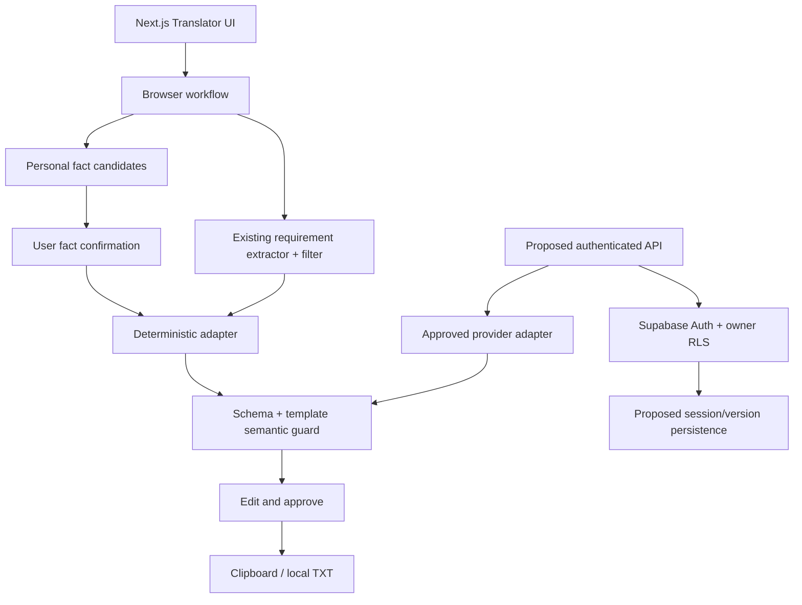
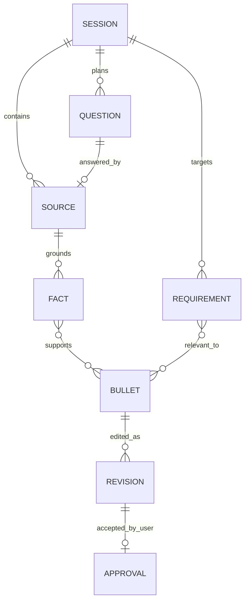

# Architecture and ADR-001

## New-stage decision — 16 October 2026

Owner authorized new Firebase Auth + Firestore accounts and sandbox subscriptions. The implementation contract is [ACCOUNTS_BILLING_STAGE](ACCOUNTS_BILLING_STAGE.md): Firebase authority for new accounts, protected server sessions/repositories, Stripe test-only hosted billing, verified server entitlements and explicit saved-session persistence. This is a planned new branch, not a claim those services are wired. Existing core-only architecture/history below remains authoritative for the preserved Translator. Supabase data/applied migrations stay intact; no UID linking by email or implicit production migration. Old conditional-auth designs below must not be mistaken for the new implementation contract.

Status, 2026-10-15: browser-only deterministic core retained; legacy runtime reduction authorized and staged in [BACKLOG](BACKLOG.md). The persistence/provider diagram below is conditional historical design, not required implementation. Frozen installation reconfirmed Next.js 16.3.7 / React 19.2.8 / TypeScript 5.9.3 / pnpm 11.25.0 / Vitest 5.0.2 / Playwright 1.61.1, Supabase JS 2.117.2 and SSR 0.12.7. Actual PostgreSQL server version not inspected.

## Reuse decision

| Module | Decision | Constraint |
|---|---|---|
| `job-description/requirements.ts` | Extracted unchanged from `analysis/requirements.ts`; one shared implementation | Core keeps Frontend allowlist, negation and instruction-line filters; extractor alone is not a claim guard |
| `analysis/matcher.ts` / `schema.ts` | Retire with old assessment consumers | Lexical overlap is not semantic grounding |
| `next-steps/`, `credential-versions/`, `cv-export/` | Retire with their routes/APIs | Core already owns its review invalidation and accepted-only local TXT |
| Auth / Supabase runtime | Retire after all consumers, including shared shell, are removed | Until then preserve authorization; applied migrations/data remain untouched |

Eight migrations through `20261008_m15_atomic_next_steps.sql` are retained unchanged. `cv_draft_claims` enforces `claim_text = source_excerpt`; M15 checks source findings transactionally. New translated text cannot satisfy that invariant. Do not weaken it or force Translator into it.

## Frontend contract freeze — CF-02

No props, exported types, adapter signatures, IDs, accessible labels or frontend-owned files change in CF-03. `src/lib/experience-translator/types.ts` remains the authoritative shape:

- `Intake { project, jd }`; four optional `Answers` keys: contribution, technology, outcome, reference. `prepareSession` returns intake, exact sources, initially unconfirmed facts, requirements and planned questions. `confirmFacts` returns a new session and rejects unavailable/duplicate IDs.
- Facts retain `id/code/label/sourceId/excerpt/start/end/confirmed/evidenceKind: "user_statement"`; requirements retain `id/code/label/excerpt` and never supply experience claims. `Bullet { id, text, factIds, requirementIds }`; `ReviewedBullet` adds current text, edited/accepted/rejected and optional detached state.
- `TranslatorAdapter.generate(session, AbortSignal): Promise<unknown>`; `generateBullets` validates against a trusted snapshot. Default timeout 3000ms, capped at 10000ms; default one timeout retry, at most two attempts. Invalid output/non-timeout failures fail immediately with controlled `TranslatorError`; inputs/edits remain available.
- UI states remain intake → interview/fact confirmation → bullets → review. Sufficient input skips questions, not fact confirmation. Answer change/skip invalidates fact review; restarting intake clears candidates. Successful regeneration preserves user edits and resets approval; detached edits lose source IDs. Editing/rejecting resets acceptance. Only accepted current non-rejected wording enters copy/TXT.
- Clear discards session state and invalidates in-flight generation. Reload/close discards React memory; no browser persistence, input-bearing URL, API, provider or database save is introduced.

This records observed interfaces for frontend owners, not their acknowledgment. See BACKLOG for the concrete pending shell/route patch boundary. Existing private APIs still require authorization until retired.

Decision: pure browser types, bounded extraction, controlled English templates, semantic validation by recomposition from confirmed personal facts, user review. Avoid migrations before a persistence ADR and approval. New authenticated persistence may use one session JSON document and versions rather than seven tables; final schema must be reviewed after OP-05. No schema is approved here.

## Implemented versus future system

Future branch is a design, not an implemented API. There is no translator server endpoint, automatic external model registration or DB save.

## Logical data model (in-memory; not database tables)

Sources are project or numbered answer fields; facts contain stable IDs, exact excerpt, code, source ID, self-report and personal-attribution classification. Requirement IDs refer only to JD wording. Bullets contain immutable generated text, fact IDs, requirement IDs; current edit and accepted/rejected state are separate. Stable template IDs prevent regeneration duplicates. A manually edited bullet is no longer template-verified; show original sources as context, not verification of the edit.

## Contracts / threat model

- Intake: project 30–6000 characters; JD 30–15000; four answers at most 1000 each; no control characters. Reject unsupported job family with clear guidance.
- Structured output: `{ bullets: [{ id, text, factIds, requirementIds }] }`, 0–3 unique candidates. JSON is parsed with controlled errors. Full generated text and ID lists must equal trusted recomposition, not just contain an existing fact ID.
- Treat all strings as untrusted data: React text rendering, no HTML insertion, eval, prompt execution or URL fetch. Instruction-bearing lines and negated/ambiguous facts are excluded conservatively. User reviews original excerpts.
- No metrics/leadership/employment templates. Technology-only mentions cannot become completed-work claims. Team contributions require personal attribution or a contextual personal-contribution answer.
- Adapter accepts AbortSignal, bounded timeout/retry; only local deterministic adapter is wired. Timeout discards attempt, no persistence; user edits survive regeneration. No production model semantic-verification claim is made.
- Clipboard requires explicit acceptance; browser denial surfaces manual-copy guidance. Clear discards intake, answers, facts, candidates, edits and approvals.
- Supabase proxy may refresh an existing Auth session on page navigation if configured. It receives the URL/cookies, not Translator input. Do not promise zero site network requests. Project/JD text is not in query strings, server props, logs or storage.
- Existing authenticated records require unchanged server authorization/RLS. Any future API needs server validation, rate limits, owner/session isolation, idempotency, no raw logging, deletion/retention review and two-user tests before real data.
