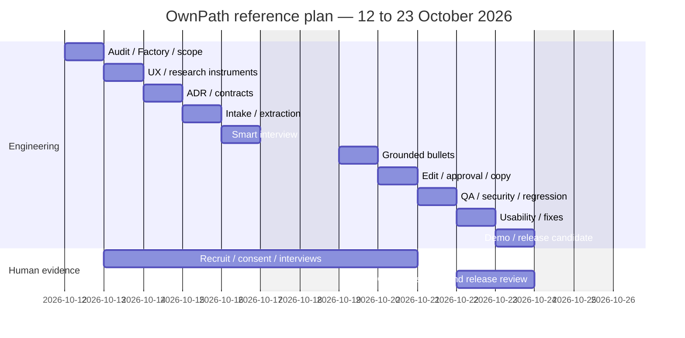

# Execution backlog and estimated roadmap

One writer per worktree. Read-only reviewers may run concurrently. Every issue records actual evidence in STATUS; formal production gate remains pending. Estimate units are focused engineer days, not elapsed commitments.

| Issue / scope | Files | Dependency | Owner | Definition of Done / checks | Evidence | Estimate | Gate / rollback |
|---|---|---|---|---|---|---|---|
| OP-00 Audit | STATUS, existing docs/source read | None | Auditor | HEAD/base, dirty trees preserved, CI, versions, reuse, 8 migrations inventoried; fresh baseline | Git/API + test logs | 0.5 | Authorized read-only; no mutation |
| OP-01 Scope/PRD | PRD, existing README/state/tracker | OP-00 | Lead | Persona, flow, non-goals, approval distinction, no fabricated signature | Owner handoff + PRD | 0.5 | Synthetic planning authorized; revert own docs |
| OP-02 Research/workarounds | RESEARCH_PLAN, existing CP2 records | OP-01 | Owner/team + Auditor | Real consented interviews, dated official alternatives + actual workaround, reviewed evidence | Pending actual TU/SV/CM IDs | 1 + recruitment | Human input pending; retain historical evidence |
| OP-03 ADR/threat/reuse | ARCHITECTURE, FLOWS | OP-01 | Architect | In-memory/proposed persistence distinction, semantic guard and privacy review | ADR-001 | 0.5 | Design proposed; no DB change |
| OP-04 Four-screen UX | Translator client, CSS | OP-03 | Core Engineer | Intake/interview/bullets/review, keyboard labels, empty/error/loading | Component tests; browser/mobile pending if unavailable | 0.75 | Synthetic only; remove route |
| OP-05 Contract/provenance | translator types/engine + tests | OP-03 | Core Engineer | Exact sources, personal facts, schema+semantic validation, no JD facts | Controlled fixtures | 0.5 | Synthetic only; revert isolated module |
| OP-06 Intake | Translator client + engine | OP-04, OP-05 | Core Engineer | One bounded project/JD; recover validation errors | Intake tests | 0.5 | Synthetic only; remove route |
| OP-07 Extract/match | engine, requirements reuse | OP-06 | Core Engineer | Negation/instruction/team guard, missing is not lack | TC01/02/06/08 | 0.75 | Synthetic only; revert new wrapper |
| OP-08 Interview | engine/client | OP-07 | Core Engineer | No repeated known facts; 2–4 missing questions; skip | TC03/07 | 0.5 | Synthetic only; revert own files |
| OP-09 Bullets | composer/adapter/validator | OP-08 | Core Engineer | 0–3 English bullets, exact facts, no fabricated metrics; malformed/timeout bounded | TC04/05/09/10/14 | 1 | Synthetic only; adapter stays local |
| OP-10 Review/copy | client/review helpers | OP-09 | Core Engineer | Edit resets approval, regenerate preserves edit, accepted-only copy/TXT, clear | TC11/13 interactions | 0.75 | Memory only; DB/save/export integration blocked |
| OP-11 QA/security | tests, TEST_STRATEGY, STATUS | OP-10 | Independent QA | Full unit/integration/lint/types/build; injection; existing regression; browser/mobile and RLS boundaries explicit | Fresh commands and reviewer findings | 1 | No 'production ready'; revert branch changes |
| OP-12 Usability study | real research records | OP-02, OP-11 | Owner/team | Counterbalanced actual observations, accuracy/time/edit comparison | Pending actual evidence | 1 | Real consent/course gate; no invented data |
| OP-13 Demo/RC/handoff | STATUS, demo script, pitch | OP-11, OP-12 | Lead + Owner | Honest deterministic demo, exact commands/limitations, explicit release decision | Draft PR + acceptance | 0.75 | Owner release pending; no merge/deploy |
| OP-14 Provider (conditional) | future server adapter/contracts | OP-02/03/05 + approval | Core Engineer + Owner | Model/budget/consent/privacy approved, server validation/rate-limit/Auth/isolation/idempotency, timeout tests | Approval not supplied | TBD | Blocked; local adapter fallback |

Factory configuration and version-aware setup belong to OP-00/01, `docs/ai-factory/` and `scripts/setup-ownpath-factory.mjs`. Runtime validation waits for actual owner OpenCode installation; no cost/provider is selected.

## Ten working days (estimate; research and engineering can overlap)

A synthetic vertical slice can advance ahead of this schedule; that does not advance the human gates. Re-estimate after owner study availability and actual browser results.
