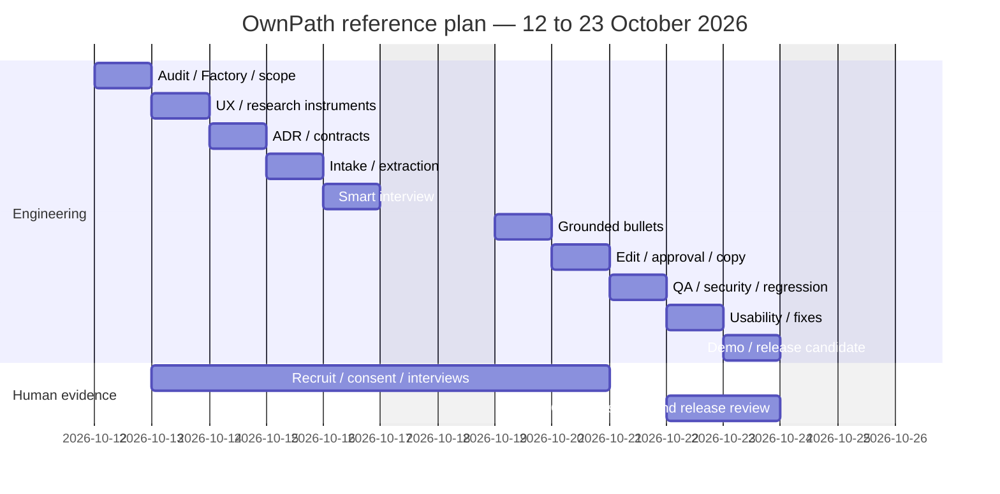

# Execution backlog and estimated roadmap

## Active three-person execution — CF-04A

Next owner-directed implementation runs in OpenCode. [OPENCODE_NEXT_BUILD](OPENCODE_NEXT_BUILD.md) is the execution instruction for F-00-RUNTIME, CF-06-BE concrete-defect hardening, pending compiled acceptance and separate review. Preparation does not complete those tasks. Latest handoff checkpoint `459c17a` Quality PR run `38699400376` was freshly observed successful; frontend branches remained unpublished at this refresh.

Owner approved starting the plan on 15 October with two separate frontend developers. [TEAM_WORKFLOW](TEAM_WORKFLOW.md) assigns disjoint backend/shell/Translator roots, preserves the types contract and defines the combined integration gate. Their local state/acknowledgment is still unknown.

- [x] Refresh published backend PR/head and reproduce baseline: 429 tests / 55 files.
- [x] Prepare ownership preflight, backend-only factory templates and ready task cards for both frontend developers. Templates are tested; actual OpenCode activation remains unavailable here.
- [x] CF-04A implementation: retire 17 API handlers and six API test files; relocate three retained print-route cases. All frontend source and existing domain libraries remain untouched.
- [x] Backend candidate verification: 403 tests / 52 files, lint/types/build, ownership check, 119 compiled API absence checks, landing/Translator HTTP smoke.
- [ ] Separate reviewer acceptance; this execution has self-review only.
- [ ] Fresh compiled Chromium journey: download failed in this environment; prior browser passes are historical.
- [ ] FE1-CF04B legacy pages/navigation removal and FE2 retained-UI review by frontend owners.
- [ ] Combined integration followed by CF-04C/05 consumer/Auth/package/config retirement.

CF-04 as a whole and CF-05–09 remain open. Do not merge/deploy API retirement alone: preserved legacy pages still call the retired endpoints. Tooling/docs can land separately from API retirement so frontend branches can share the guard without losing their old APIs early.

## Core-only execution tracker — 15 October 2026

This owner-authorized reduction supersedes older preserve-all-modules instructions and the historical ten-day estimate below. One writer: backend owner/OpenCode on `feat/ownpath-backend`. Integration/PR base: `feat/ownpath-experience-translator`; never reset an existing personal branch. The first slice isolates the shared extractor; product removal remains pending.

| Task | Owner / file scope | Dependencies / done criteria | Actual evidence / rollback |
|---|---|---|---|
| [x] CF-00 baseline | Backend; read-only Git/remote/package/CI audit | Preserve worktrees; refresh branch/PR/CI; record exact starting SHA | STATUS current audit; original M17 checkout untouched, new isolated backend worktree from `d1ec1a0` |
| [x] CF-01 scope/inventory | Backend; README, PRD, BACKLOG, STATUS | Record keep/cut/dependencies and owner decision | Inventory below; revert this bounded docs commit |
| [x] CF-02 contract and ownership record | Backend; ARCHITECTURE/HANDOVER/BACKLOG only | Record observed shapes/errors/state/clear semantics and actual file collisions | Core types/props/labels unchanged; frontend local work/acknowledgment still unknown; revert docs |
| [x] CF-03 shared extraction | Backend; `src/lib/job-description/*`, analysis imports/tests, core engine import | One implementation independent of analysis; preserve existing extractor assertions and core behavior | Before: 66 tests/3 files; after: 66/4 targeted PASS. Full candidate checks recorded in STATUS; revert extraction commit |
| [ ] CF-04 legacy removal | Backend APIs/domain; frontend owners pages/shell | CF-03; coordinate exact route patch, audit transitive imports; removed endpoints unavailable | Pending; retire in bounded feature batches with targeted tests; revert each batch |
| [ ] CF-05 dependencies/config/CI | Backend, one coordinated writer for shared config | CF-04; no remaining consumers before package/lock removal; retain quality/browser/security gates | Pending; retire only legacy-specific harnesses after runtime removal; revert each tooling batch |
| [ ] CF-06 core hardening | Backend domain; UI fixes only with frontend coordination | Inspect failure paths, fix concrete defects and verify meaningful regressions | Pending; no unrelated feature expansion; revert isolated fix |
| [ ] CF-07 final core acceptance | Backend tooling/QA | CF-04–06; lint/types/full retained tests/build + actual compiled browser and retired-route/API checks | Pending for reduced application; current extraction checks are not completion of pruning |
| [ ] CF-08 manual checks | Owner/frontend/QA; MANUAL_ACCEPTANCE | Actual device/zoom/reader/clipboard/owner execution with source/environment | Pending; no fabricated manual result; preserve observations |
| [ ] CF-09 handoff/publication | Backend docs/demo/personal draft PR | Verified candidate, exact evidence and remaining work; target integration | First-slice handoff/publication recorded in STATUS; final reduced-product handoff pending; revert own docs/commits |

### Keep/cut/dependency inventory

Inventory describes source observed at `d1ec1a0`, not completed deletion. No applied migration or stored data is removed.

| Decision | Pages / APIs | Modules / packages / follow-through |
|---|---|---|
| Keep core | `/experience-translator`, minimal `/` and app shell | `src/lib/experience-translator/**`, `src/lib/job-description/requirements*`, `src/lib/http/security-headers*`; core UI/domain/browser tests; Next/React/TS stack |
| Cut intake/assessment | `/assessment`, `/analysis/[id]`, `/api/intake/cv`, `/api/intake/cv/[id]`, `/api/intake/jobs`, `/api/intake/jobs/[id]`, `/api/analysis`, `/api/analysis/[id]` | `intake/`, remaining `analysis/`; `mammoth`, `pdf-parse` only after consumers removed; extractor now independent |
| Cut roadmaps | `/analysis/[id]/next-steps`, `/api/analysis/[id]/next-steps` | `next-steps/`; associated analysis interactions and workspace tests |
| Cut opportunities | `/opportunities`, `/api/opportunities`, `/api/opportunities/[id]` | `opportunities/`, curated sources and related tests; no scraper needs adding |
| Cut persistent workspace | `/saved-work`, `/api/saved-work` | `saved-work/`; shared WorkspaceHeader navigation/Auth must be coordinated |
| Cut share/expert/proof/version | `/review/[token]`, `/expert/credential-reviews`, `/credential-versions`, `/credential-versions/[id]/print`; `/api/review/[token]`, `/api/analysis/[id]/review-shares`, `/api/expert/credential-reviews`, `/api/credential-versions`, `/api/credential-versions/documents`, `/api/credential-versions/evidence/[id]`, `/api/credential-versions/[id]/export` | `review-links/`, `credential-versions/`, `cv-export/`; remove `docx` after export consumers; preserve accepted-only core clipboard/TXT |
| Cut Auth when consumers gone | `/sign-in`, `/sign-up`, `/auth/callback`, shared `src/app/auth/` | `supabase/`, `src/proxy.ts`, `@supabase/ssr`, `@supabase/supabase-js`; currently imported by legacy pages/APIs and `components/workspace-header.tsx` |
| Simplify config/tooling | `next.config.ts` legacy header rules; obsolete navigation | Keep global security and Translator no-store/noindex headers; retain lint/types/tests/build, compiled translator harness/security tests. Review `local-acceptance.yml`, `ci-local-acceptance`, legacy browser/policy/preview/workspace scripts and package commands after consumers retire; current checks still apply to present runtime |
| Preserve evidence/history | `supabase/migrations/**`, historical docs/research and CP2 records | Do not rewrite applied history or delete live data. Keep useful research tooling outside app runtime; old results remain dated evidence, not new acceptance |

### Concrete frontend coordination boundary

No frontend-owned file is edited by this slice. No teammate branch is published at audit; there is no observed remote file collision, and local-only changes are unknown. The following is a patch request for the owner to coordinate, not an external message or claimed agreement:

1. Frontend 1 (`feat/ownpath-ui-shell`) owns `src/app/page.tsx`, `layout.tsx`, `globals.css`, `src/components/**` and shell tests. Remove the landing `/sign-in` link (currently page line 32), reconcile legacy career-readiness/assessment report copy, and remove `WorkspaceHeader`/`evidence-labels` only after legacy consumers retire. Its nav currently points to `/assessment`, `/saved-work`, `/credential-versions`, `/opportunities`, `/expert/credential-reviews`; these are all obsolete. Keep the Translator CTA and minimal accessible shell.
2. Frontend 2 (`feat/ownpath-translator-ui`) owns `src/app/experience-translator/**` and scoped tests/styles. No file movement, label, prop or adapter change required for CF-03. Preserve exact accessibility test labels and the frozen contract in ARCHITECTURE.
3. Legacy page directories above have no confirmed teammate owner. Agree one writer and integration point for their deletion, plus shared `next.config.ts`/package/CI changes. Backend may remove dead API handlers/tests independently, but library/Auth/package deletion must wait until all page/component consumers are reconciled. Do not merge or overwrite a teammate's unknown local work.

### First-slice verification

Move the existing extractor, without algorithm changes or a compatibility duplicate, into `job-description/requirements.ts`; update engine/provider/workflow imports. Relocate the existing three extraction tests out of the legacy analysis suite so they survive its later removal. Before/after 66 targeted tests passed. No tests or product routes retired in this slice; full-suite file count increases by one solely because those three assertions now have an independent core test file. See STATUS for candidate commands and publication. Next bounded implementation task is CF-04 API retirement after auditing handler imports and retaining libraries still needed by pages.

## Historical prototype backlog

One writer per worktree. Read-only reviewers may run concurrently. Every issue records actual evidence in STATUS; formal production gate remains pending. Estimate units are focused engineer days, not elapsed commitments.

| Issue / scope | Files | Dependency | Owner | Definition of Done / checks | Evidence | Estimate | Gate / rollback |
|---|---|---|---|---|---|---|---|
| OP-00 Audit | STATUS, existing docs/source read | None | Auditor | HEAD/base, dirty trees preserved, CI, versions, reuse, 8 migrations inventoried; fresh baseline | Git/API + test logs | 0.5 | Authorized read-only; no mutation |
| OP-01 Scope/PRD | PRD, existing README/state/tracker | OP-00 | Lead | Persona, flow, non-goals, approval distinction, no fabricated signature | Owner handoff + PRD | 0.5 | Synthetic planning authorized; revert own docs |
| OP-02 Research/workarounds | RESEARCH_PLAN, existing CP2 records | OP-01 | Owner/team + Auditor | Real consented interviews, dated official alternatives + actual workaround, reviewed evidence | Pending actual TU/SV/CM IDs | 1 + recruitment | Human input pending; retain historical evidence |
| OP-03 ADR/threat/reuse | ARCHITECTURE, FLOWS | OP-01 | Architect | In-memory/proposed persistence distinction, semantic guard and privacy review | ADR-001 | 0.5 | Design proposed; no DB change |
| OP-04 Four-screen UX | Translator client, CSS | OP-03 | Core Engineer | Intake/interview/bullets/review, keyboard labels, empty/error/loading | Component tests; browser/mobile pending if unavailable | 0.75 | Synthetic only; remove route |
| OP-05 Contract/provenance | translator types/engine + tests | OP-03 | Core Engineer | Exact sources, personal facts, schema+semantic validation, no JD facts | Controlled fixtures | 0.5 | Synthetic only; revert isolated module |
| OP-06 Intake | Translator client + engine | OP-04, OP-05 | Core Engineer | One bounded project/JD; recover validation errors | Intake tests | 0.5 | Synthetic only; remove route |
| OP-07 Extract/match | engine, requirements reuse | OP-06 | Core Engineer | Negation/instruction/team guard, missing is not lack | TC01/02/06/08 | 0.75 | Synthetic only; revert new wrapper |
| OP-08 Interview | engine/client | OP-07 | Core Engineer | No repeated known facts; 2–4 missing questions; skip | TC03/07 | 0.5 | Synthetic only; revert own files |
| OP-09 Bullets | composer/adapter/validator | OP-08 | Core Engineer | 0–3 English bullets, exact facts, no fabricated metrics; malformed/timeout bounded | TC04/05/09/10/14 | 1 | Synthetic only; adapter stays local |
| OP-10 Review/copy | client/review helpers | OP-09 | Core Engineer | Edit resets approval, regenerate preserves edit, accepted-only copy/TXT, clear | TC11/13 interactions | 0.75 | Memory only; DB/save/export integration blocked |
| OP-11 QA/security | e2e/translator*, e2e/auth-flow.spec.ts, e2e/safe-reporter.ts; scripts/ci-ownpath-browser*, e2e-local-reporter.test.mjs; ownpath/local-acceptance workflows, .gitignore, TEST_STRATEGY, STATUS | OP-10 | Independent QA | Full unit/integration/lint/types/build; injection; existing regression; browser/mobile and RLS boundaries explicit | Fresh commands and reviewer findings | 1 | No 'production ready'; revert branch changes |
| OP-12 Usability study | real research records | OP-02, OP-11 | Owner/team | Counterbalanced actual observations, accuracy/time/edit comparison | Pending actual evidence | 1 | Real consent/course gate; no invented data |
| OP-13 Demo/RC/handoff | STATUS, demo script, pitch | OP-11, OP-12 | Lead + Owner | Honest deterministic demo, exact commands/limitations, explicit release decision | Draft PR + acceptance | 0.75 | Owner release pending; no merge/deploy |
| OP-14 Provider (conditional) | future server adapter/contracts | OP-02/03/05 + approval | Core Engineer + Owner | Model/budget/consent/privacy approved, server validation/rate-limit/Auth/isolation/idempotency, timeout tests | Approval not supplied | TBD | Blocked; local adapter fallback |

Factory configuration and version-aware setup belong to OP-00/01, `docs/ai-factory/` and `scripts/setup-ownpath-factory.mjs`. Agent/command discovery and loaded permission rules passed using actual official OpenCode 1.18.35 in an isolated synthetic fixture. Owner-local global/MCP settings, permission tool execution and V2 runtime remain unverified; no cost/provider is selected.

## Ten working days (estimate; research and engineering can overlap)

A synthetic vertical slice can advance ahead of this schedule; that does not advance the human gates. Re-estimate after owner study availability and actual browser results.

## Current checkpoint

At current code/test SHA `d2979c6a8c074dabe245ba5fa79991d65ae6de93`, OP-04–10 synthetic implementation and OP-11 automated/independent acceptance passed, including seven compiled Translator cases / 30 steps and disposable backend regression. OP-13 synthetic demo/handoff is ready. OP-02/12 real research and final OP-13 release decision remain pending; OP-14 provider remains conditional. Manual device/accessibility checks and owner-local Factory tool execution are still open. See STATUS for exact commands/run links; the schedule above remains an estimate, not a claim of completed human evidence.

## Follow-up preparation scope

User instructed continuing the checklist/workflow on 2026-10-12. The bounded follow-up adds `scripts/verify-ownpath-factory.mjs` and its policy-regression tests, fixes explicit docs paths in Factory prompts, and updates `docs/ownpath/PILOT_PROTOCOL.md`, `MANUAL_ACCEPTANCE.md` plus planning/runbook/handoff records. E01 operational measurement/rubric definition is complete as preparation; actual study and owner-machine/manual gates stay open. Single writer; independent reviewer reads only. No app/DB/provider implementation or migration change. Rollback is removal/revert of these isolated scripts/docs; existing profiles are never automatically overwritten.

Follow-up source checkpoint `2cee287135d22234a77e288cf1c04d905dfd2ea9` passed full Quality push/PR and [synthetic acceptance](https://github.com/EnzoReacher/EXE/actions/runs/38210654756), including both cleanup steps, with 416 tests / 53 files. E01 protocol preparation is done; A06, manual device/owner checks and D03–D07/E02–E05 human study remain open.

## Keyboard and fallback acceptance follow-up

Authorized synthetic QA continuation owns `src/app/experience-translator/translator.tsx`, `translator.test.tsx`, `translator.css`, `e2e/translator.spec.ts`, `scripts/ci-ownpath-browser.mjs` and relevant status/test docs only. Fix repeated Skip accessible names; exercise keyboard-only transitions/selective skip/reject/restore, injected clipboard rejection and long-source narrow layout in the existing compiled loopback CI harness. DoD is local checks, actual browser/legacy CI results and read-only independent review; whole manual/device/participant/release gates stay open. No DB/provider/migration change; revert this isolated UI-label/test diff if needed.

Completed at source `c89fc32b28ca015f0ffbf5c60ee5d70709295e43`: 417 tests / 53 files, Quality push/PR, [synthetic acceptance](https://github.com/EnzoReacher/EXE/actions/runs/38216785533) seven compiled cases / 30 steps, all six disposable backend commands and cleanup passed. Read-only QA reviewed the UI/test scope and exact question-label correction after the first compiled run exposed partial-label collisions. No unresolved concrete blocker in this bounded synthetic scope. C01–C06 evidence renewed; C07–C10, owner-local/research/release gates remain open.

## Next workflow support — private pilot instrument

Owner instructed continuing on 2026-10-12. Root sole writer owns `scripts/ownpath-pilot.mjs`, its synthetic regression tests and `docs/ownpath/PILOT_DATA_RUNBOOK.md` plus protocol/research/status/handoff links. Bounded E02/E03 preparation: strict private structured observations, fixed sequence/checkpoint, explicit missing slots/failures/caps, human-review-gated completion, separate coaching/fact requests and generated/final safety, within-pair statistics and private drafts requiring review. No collection, recruitment, raw research record, app/API/DB/provider/migration or register/approval write. Independent reviewer reads only. DoD: meaningful tests, engineering checks, exact-tree branch publication and CI evidence; actual E02/E03 stay open. Rollback reverts these scripts/docs without changing app source or private observations.

Private instrument preparation completed at `d2979c6a8c074dabe245ba5fa79991d65ae6de93`: 12 focused tests, full 429/54, lint/types/build, Quality push/PR, [compiled seven cases/30 steps + backend acceptance](https://github.com/EnzoReacher/EXE/actions/runs/38219710485) and cleanup PASS. Independent read-only QA cleared schema/missing-data/math/privacy/template/runbook corrections. No participants/data/approvals added; E02/E03 actual work remains pending.
