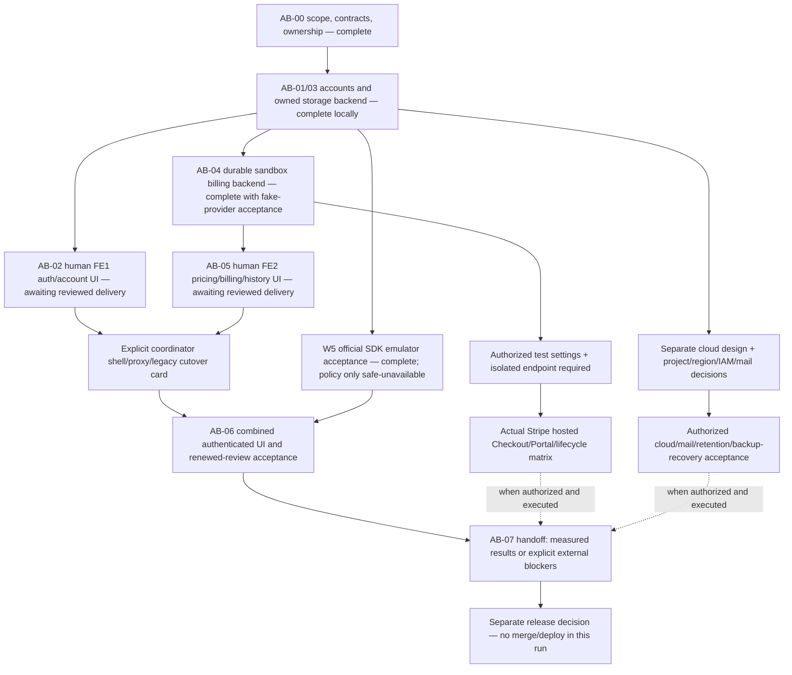
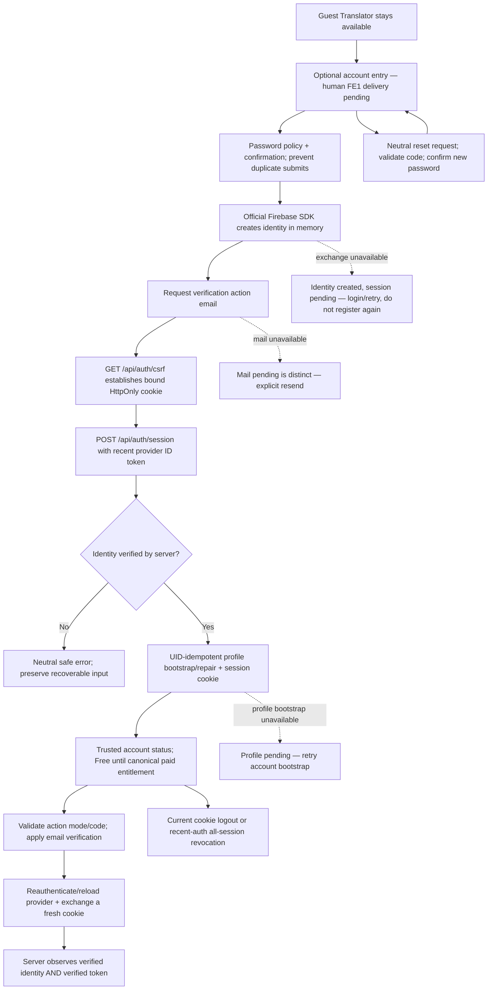
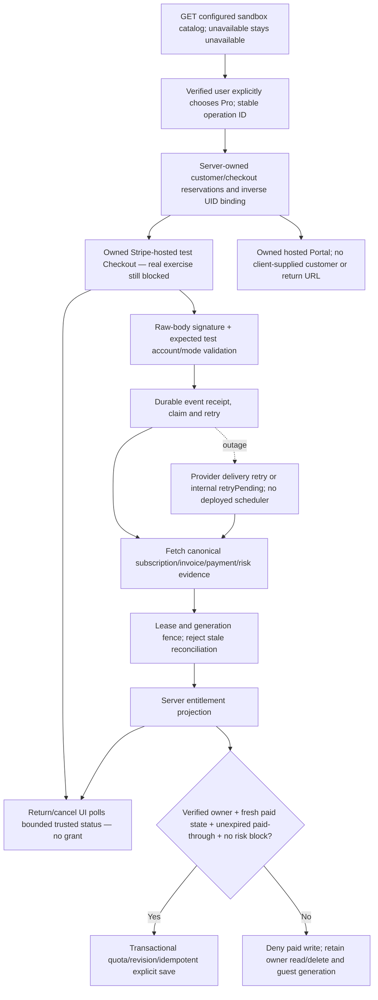
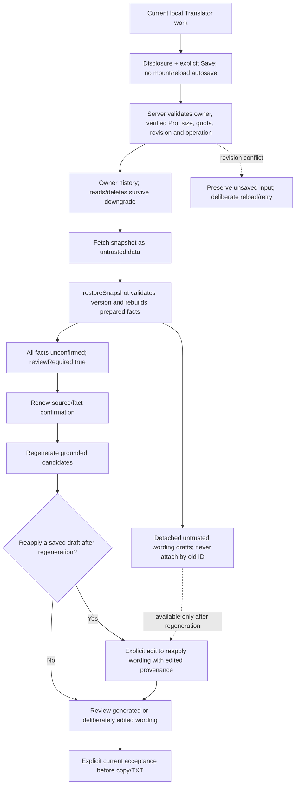
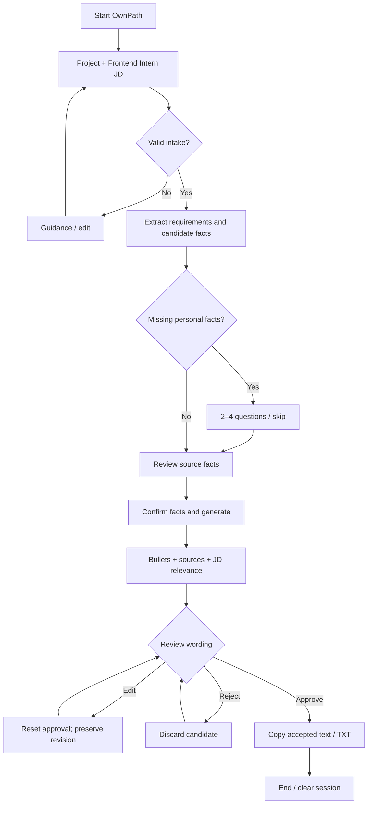
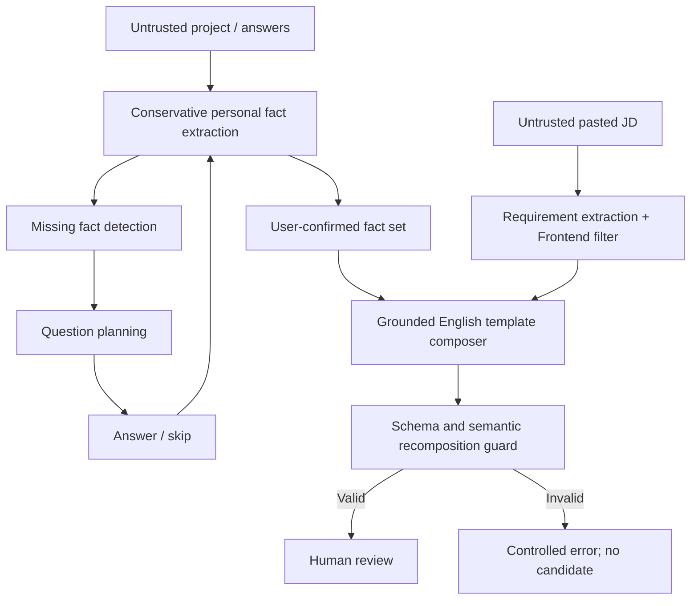
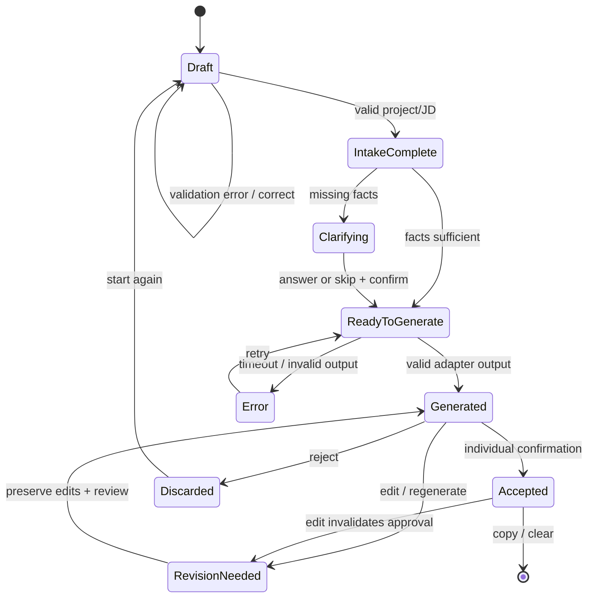
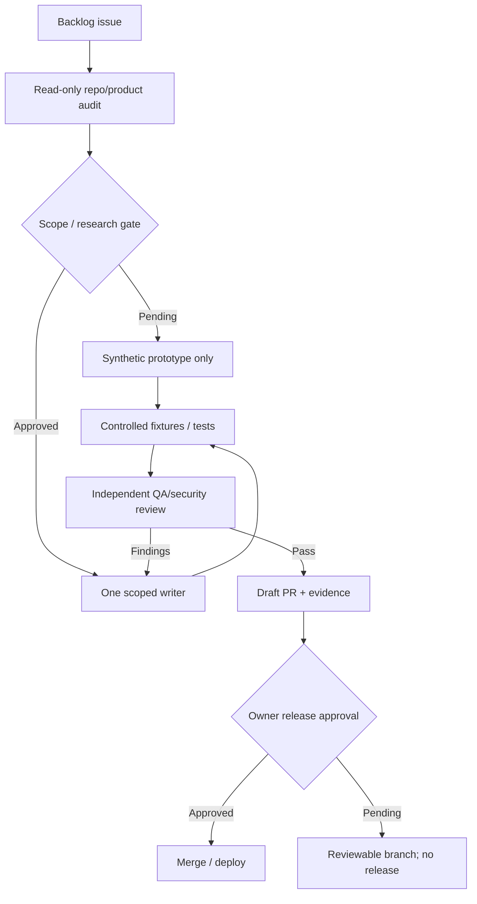

# OwnPath workflow diagrams

The guest Translator is implemented and deterministic. Accounts, owner-isolated persistence and default-off sandbox billing **backend** are implemented in explicit demo-emulator mode. Human auth/billing/history UI, combined entry cutover, actual Stripe and Firebase cloud execution remain separate gates. No external AI model is integrated. Current evidence: [AB_EVIDENCE](AB_EVIDENCE.md); ordered pickup: [AB_NEXT_STEPS](AB_NEXT_STEPS.md). Diagrams describe intended composition, not completed UI or external acceptance.

## Current execution order and dependency gates

Existing guest/API transport/emulator checks are already measured separately; W5 exercises the official browser adapter without taking over human UI. AB-07 setup/evidence preparation can proceed before external gates, but complete cloud/payment acceptance cannot. Frozen contracts do not authorize consumers to change backend authority.

## Accounts: identity, session and recovery

SDK credentials are cleared after credential operations; the HttpOnly app cookie is session authority. Invalid/used/expired action handling belongs to the UI and official SDK boundary; emulator acceptance is not mail-delivery or cloud password-policy acceptance. Shared shell/proxy retirement remains gated on reviewed frontend deliveries.

## Billing authority: return is only a status view

Billing is default-off and strict test-only. Existing acceptance uses real Firestore with a fake provider plus deterministic Stripe SDK-shaped/signature fixtures. Canonical freshness is bounded to five minutes; write authorization also checks paid-through at the time of the write. Refund/dispute history fails closed. No live or externally hosted payment was executed.

## Explicit saved history and renewed review

This restore composition is **pending FE2 implementation/review**. Backend reset/validation tests and server-seeded browser history do not establish safe combined UI export behavior.

## User journey

## Data processing

## State machine

## AI Factory lifecycle

