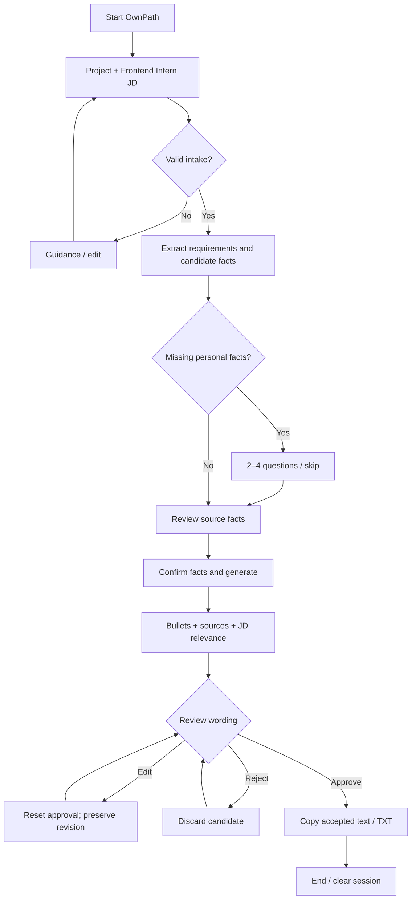
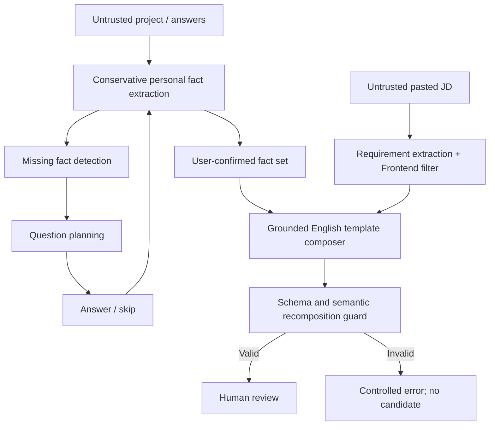
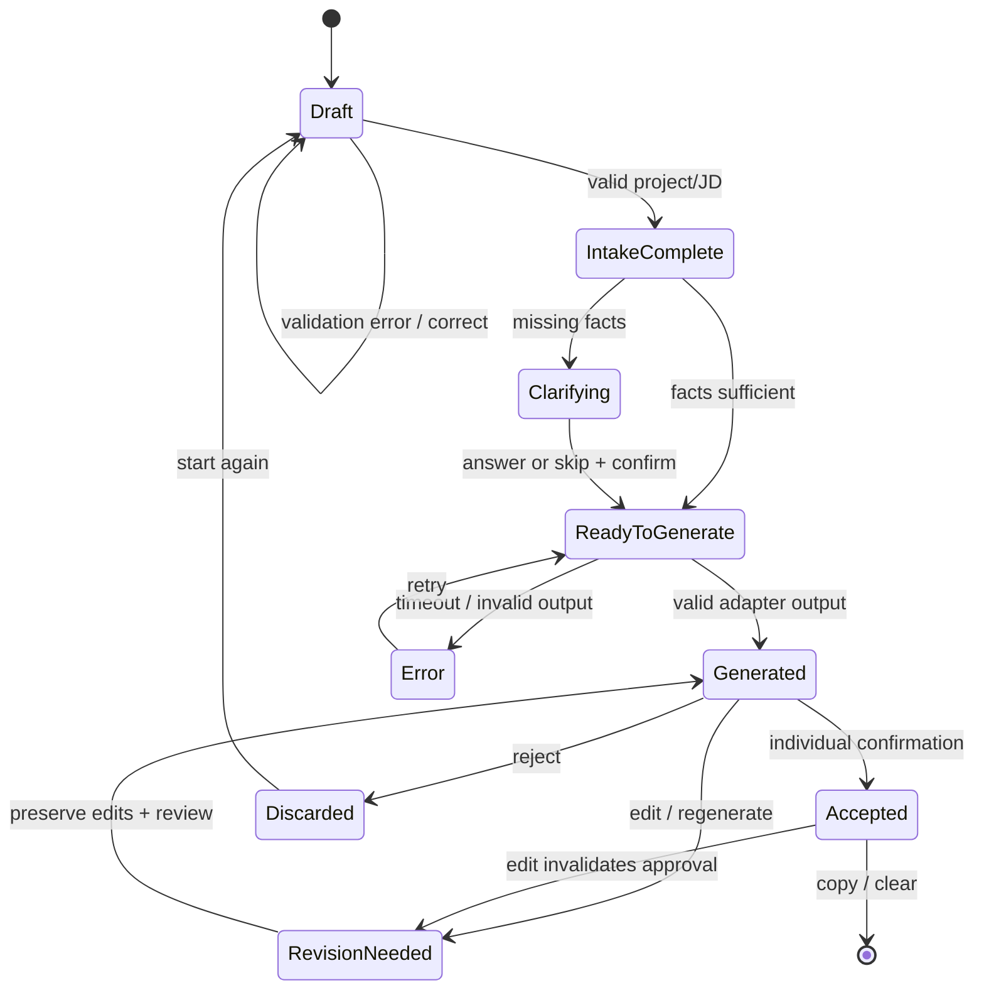
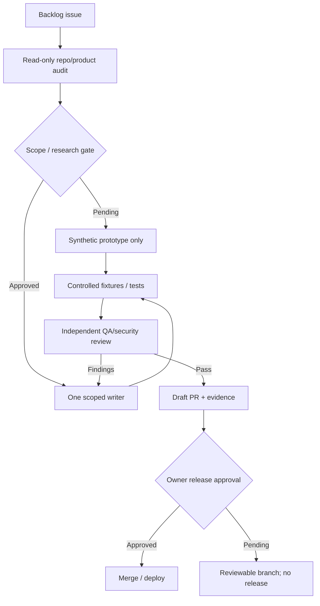

# OwnPath workflow diagrams

Implemented prototype is deterministic; authenticated persistence and external model remain proposed.

## User journey

## Data processing

## State machine

## AI Factory lifecycle

